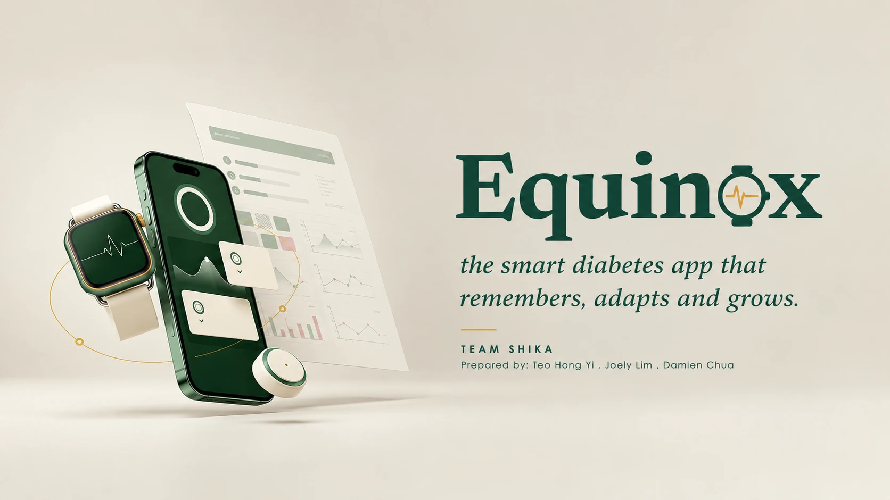
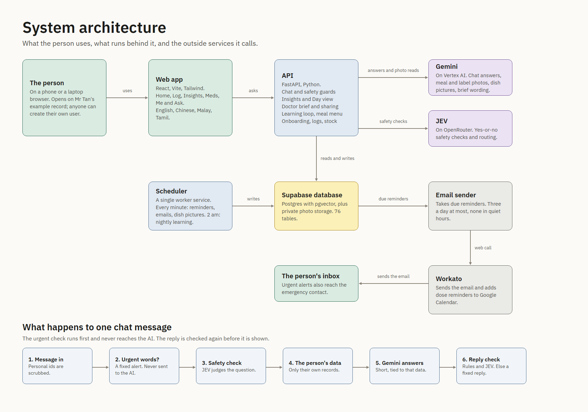
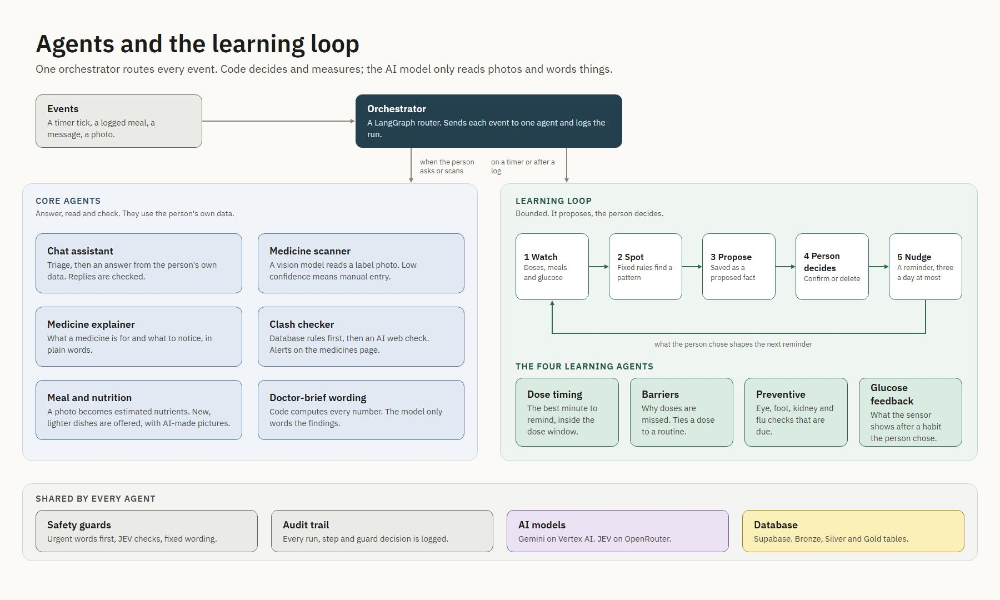
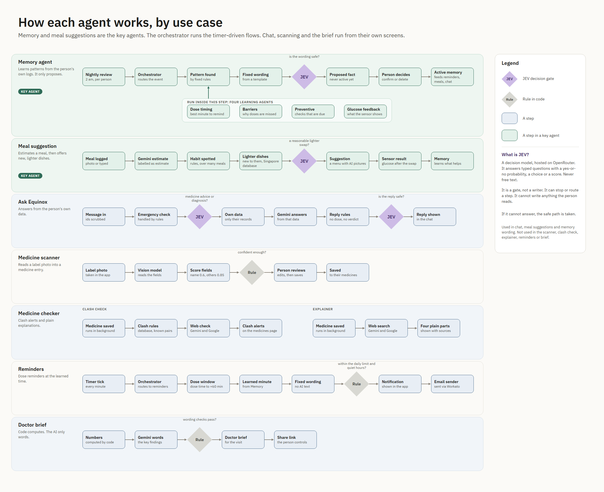
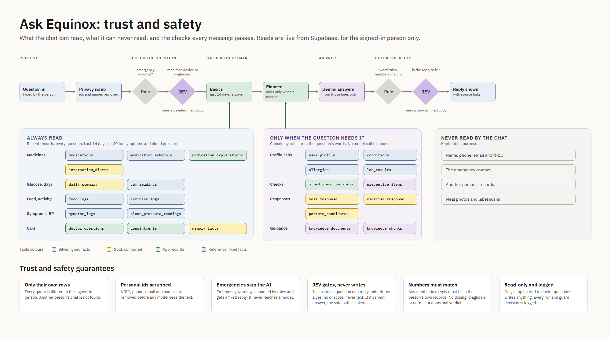
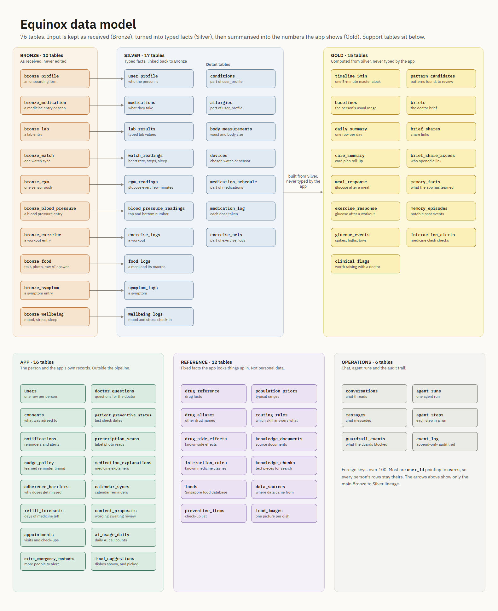
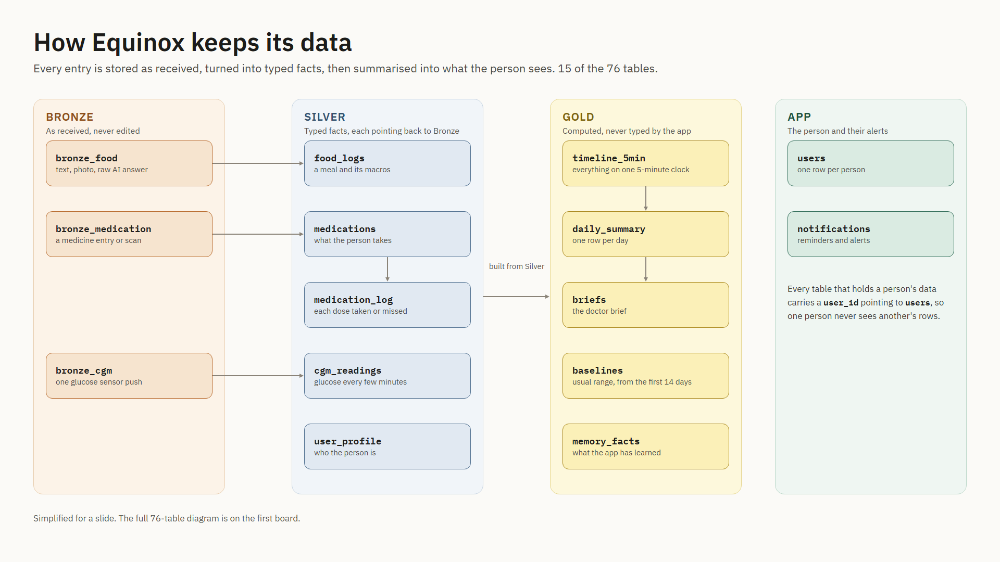

<p align="center">
  
</p>

# Equinox

**The smart diabetes app that remembers, adapts and grows.**

Equinox is an AI health companion for adults living with Type 2 diabetes. It learns each person from their own meals, medicines, glucose, activity and symptoms, helps them every day, and turns the weeks between clinic visits into a clear, evidence-backed brief for their doctor.

Equinox explains, organises and reminds. It never gives medication advice and never diagnoses.

Built by **Team Shika** (Teo Hong Yi, Joely Lim, Damien Chua) for the AI CAN DO IT Tencent Cloud Hackathon Singapore 2026, Healthcare track, Challenge 2 "AI Healthier Every Day", Scenario 2 (Type 2 diabetes self-care).

---

## The problem

A person with Type 2 diabetes spends about ten minutes with their doctor every few months and the other 360-odd days on their own. In between, they have to:

- understand several medicines, plus the supplements and traditional remedies they add;
- take them on time, every day, and remember why a dose was missed;
- make sense of glucose readings that come with no context;
- eat, move, sleep and manage stress in ways that change their glucose;
- keep up with eye, foot and kidney check-ups.

The data exists, scattered across a watch, a glucometer, a pill box and memory, but nobody joins it up. The patient cannot interpret it safely, and the doctor never sees it. The consult starts from one HbA1c number and the question "how have you been?"

## What Equinox does

Equinox gives the patient a calm, everyday companion and gives the doctor the notes they always wished they had.

| Typical diabetes app | Equinox |
|---|---|
| Logs data for the patient to look at | Turns the logs into a one-page **doctor brief**, so the doctor is a first-class user |
| "Take your pill" reminders | Asks **why a dose was missed** (side effects, cost, ran out) and reports the pattern |
| Generic diet advice | Learns which local foods raise *this* person's glucose, and suggests lighter dishes they have not tried |
| Fixed-threshold alerts | Tracks each measure against the person's **own baseline**, so drift shows up early |
| A chatbot that answers anything | A **bounded assistant**: a safety gate, and interaction checks from a database, not from a language model |
| Hidden "AI memory" | **What Equinox has learned about you**: every learned fact shows its evidence and can be confirmed, corrected or deleted |
| One language | Explanations in English, Mandarin, Malay and Tamil |

## Key features

- **Home** with today's doses, a health overview, a day-by-day calendar of what was logged, and a daily summary compared with the person's usual.
- **Medicine scanning and explainer.** Photograph a label; Equinox reads it, adds it to the medicine list and explains it in plain words.
- **Clash checker.** Drug-drug, drug-supplement and drug-herbal interactions, looked up in a reference database.
- **Medication tracking.** Reminders, a status calendar showing what was taken and what was missed, missed-dose reasons, and refill forecasts. Reminders can also reach Google Calendar and e-mail through Workato.
- **Easy logging.** Meals by photo (the AI reads the macros), blood pressure, symptoms, workouts and check-ins.
- **Insights.** Glucose, food, activity, sleep and medication views, each compared with the person's own usual.
- **Meal suggestions.** A food-delivery style menu of dishes the person has not logged and that are lighter than their usual meal, with AI-made pictures and an estimated glucose rise from their own history.
- **What Equinox has learned.** A transparent memory of food and habit patterns, with evidence, confidence and a guard model that checks each lesson before it is kept.
- **Doctor brief.** A printable report with glucose, blood pressure, SpO2 and heart-rate charts, medication adherence, symptoms, food and workouts, filterable by topic, plus a **private share link** the doctor can open without an account.
- **Companion chat.** Answers questions about the person's own record, within safety guardrails; urgent symptoms go to a fixed escalation screen.
- **Multilingual, accessible design.** Text size controls, light and dark themes, and layouts for phone, tablet and laptop.

## Responsible by design

- No medication advice, dose changes or diagnoses. Interaction checks are a database lookup.
- Urgent symptoms bypass the AI and show a fixed safety message.
- Every glucose estimate is labelled as an estimate; with no personal history there is no number.
- The person can see, correct and delete everything Equinox has learned.
- The example record (Mr Tan) is read-only; anyone can create their own user.

> Equinox is a self-care and information tool. It is not a medical device and does not replace a clinician.

## How it is built

| Layer | Technology |
|---|---|
| Web app | React, TypeScript, Vite, Tailwind, TanStack Query, react-i18next |
| API | Python, FastAPI, background jobs with APScheduler, LangGraph agents |
| Data | PostgreSQL (Supabase) with Alembic migrations; private file storage for photos |
| AI | Google Vertex AI: Gemini for text and photos, a Gemini image model for dish pictures, embeddings for memory; ElevenLabs for speech |
| Integrations | Workato (calendar reminders and e-mail), Google Cloud Vision (optional label reader, with offline OCR as the default) |
| Hosting | Firebase Hosting for the web app, Cloud Run for the API (see [docs/DEPLOYMENT.md](docs/DEPLOYMENT.md)) |

```
apps/web/            the Equinox web app
services/api/        the FastAPI backend, migrations and tests
data/demo/           demo data and its disclosure note
scripts/             seeding and tooling scripts
docs/specs/          product and architecture documents
docs/DEPLOYMENT.md   Google Cloud deployment guide
```

## Architecture

How the pieces fit together. Click an image to see it full size.

**System architecture:** what the person uses, what runs behind it and the outside services it calls.



**Agents and the learning loop:** one orchestrator routes each event; the learning loop only proposes and the person decides.



**Agent flows by use case, with JEV safety gates:**



**Ask Equinox, trust and safety:** what the chat can and can never read, and the checks every message passes.



**Data model:** Bronze (as received), Silver (typed facts) and Gold (computed numbers), plus app, reference and operations tables.





## Documentation

- [**Full project dossier**: problem, solution, every screen, ethics, feasibility, limitations and future work](docs/EQUINOX-PROJECT-DOSSIER.md)
- [Product requirements](docs/specs/prd.md)
- [Architecture](docs/specs/architecture.md)
- [App flow and features](docs/specs/app-flow-and-features.md)
- [AI models](docs/specs/ai-models.md)
- [Safety rules](docs/specs/rules.md)
- [Deploying on Google Cloud](docs/DEPLOYMENT.md)

## Team

**Team Shika:** Teo Hong Yi, Joely Lim, Damien Chua.

## Licence

Copyright (c) 2026 Team Shika. All rights reserved. Equinox is proprietary software: you may view and evaluate it, but you may not copy, modify, redistribute or use it commercially without written permission. See [LICENSE](LICENSE).
