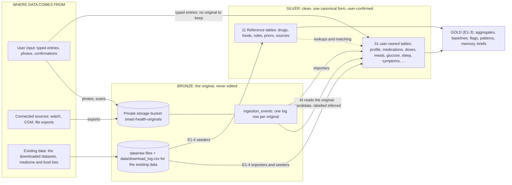
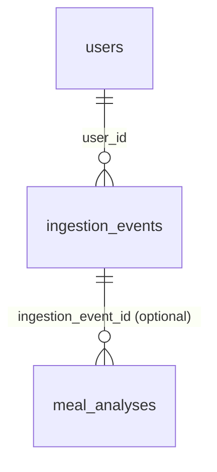
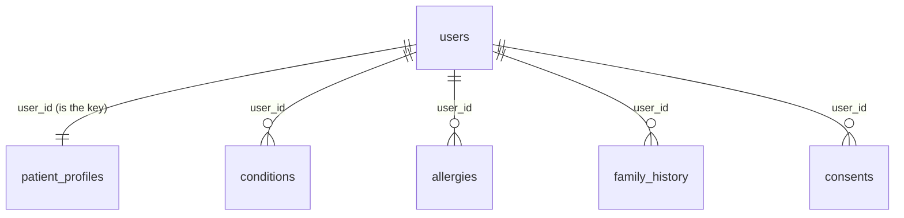
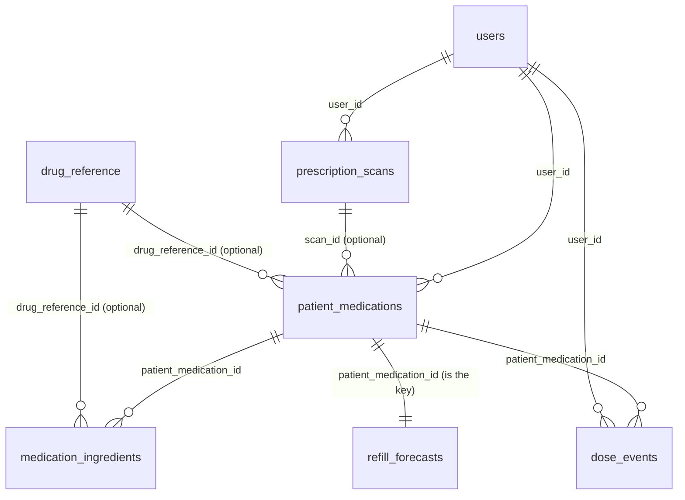
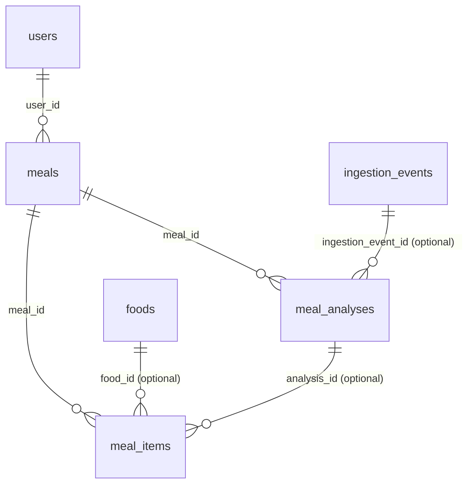
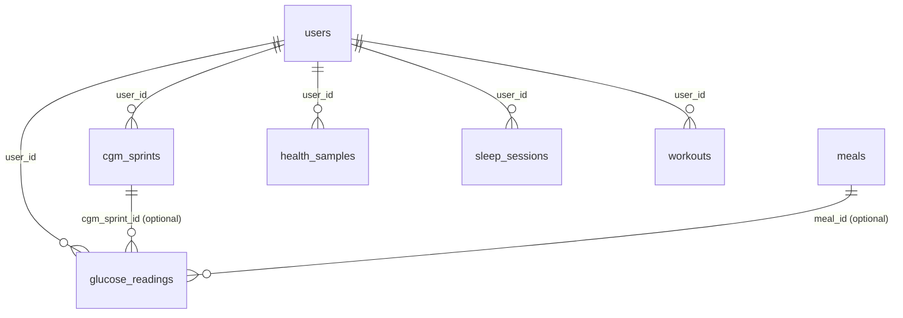
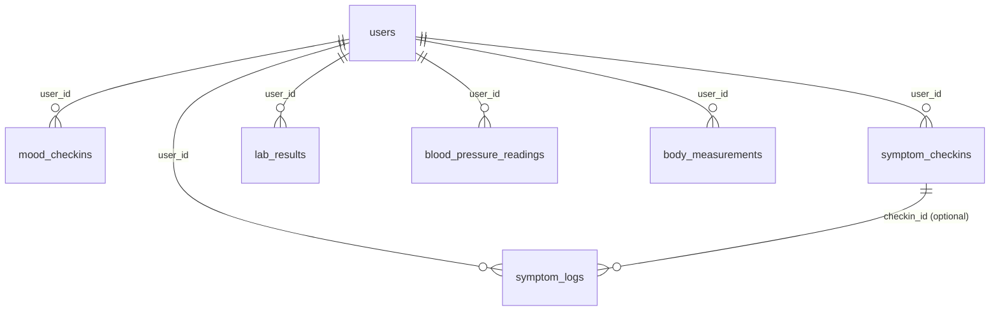
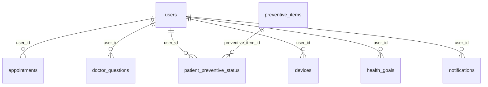
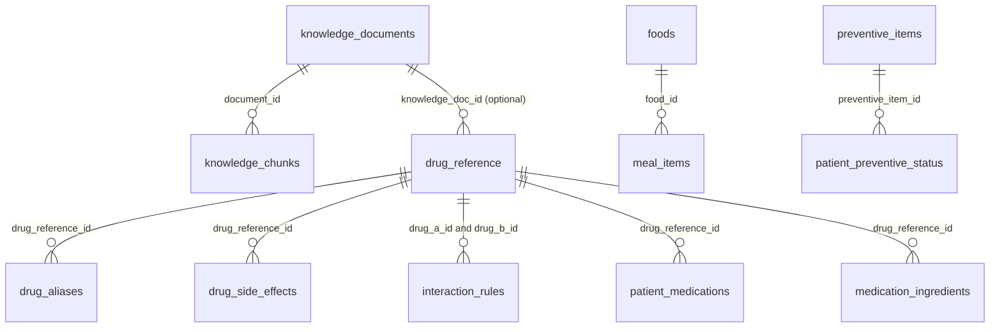

# Bronze and Silver: how the data layers work, table by table

> **History only (2026-10-05).** This walkthrough describes the v1 Bronze and Silver tables (one `ingestion_events` table and 31 Silver tables). They were replaced by data model v2 (one Bronze and one Silver table per source): see [data-model-v2.md](data-model-v2.md) and [data-flow.md](data-flow.md). On 2026-10-15 the database has 76 tables at Alembic 0040 (Bronze 10, Silver 17, Gold 15, App 16, Reference 12, Operations 6); the "43 tables" and "no sign-in screens" below describe the old state. Today the app opens on Mr Tan's read-only example record, anyone can create their own user from the avatar menu, and the user is chosen by an `X-User` header (demo-grade, no real login).

A guide to the two lower layers of the Equinox database (the **medallion** layers): what each table is for, who or what writes into it, and exactly how the columns link to each other. It covers the **43 tables** built in E1-1 and E1-2 (1 Bronze, 31 Silver, 11 Reference). Gold (derived values, memory, briefs) is built in E1-3 and is only mentioned where Silver feeds it.

**Which document wins.** The migrations in `services/api/alembic/versions/` and [schema.md](schema.md) are the source of truth; [data-flow.md](data-flow.md) is the one-page picture; [memory.md](memory.md) explains the layer rules. This page was written from the live database (every foreign key below was read from it). If it disagrees with them, they win: fix this page. Every column, with its type and unit, is in [../data_dictionary.md](../data_dictionary.md).

Contents: [1 The big picture](#1-the-big-picture) · [2 Two kinds of data](#2-two-kinds-of-data-existing-data-and-user-input) · [3 Bronze](#3-bronze-the-untouched-originals) · [4 Silver, user input](#4-silver-built-from-user-input) · [5 Reference and existing data](#5-existing-data-reference-tables-and-dataset-imports) · [6 Every link in one table](#6-every-link-between-tables) · [7 Rules and state machines](#7-rules-that-make-it-a-medallion-and-the-state-machines) · [8 Worked examples](#8-worked-examples) · [9 Gaps to settle in E1-4](#9-gaps-and-open-points)

---

## 1. The big picture

Plain-language reading:

| Layer | In one sentence | How strict |
|---|---|---|
| **Bronze** | "What we were given, exactly as we got it." A photo, a text, a watch export, a dataset file, plus one log row saying when it arrived and its fingerprint. | Never edited. The only change allowed is marking it deleted when the user asks. |
| **Silver** | "What it means, cleaned." Every value in one standard form (UTC time, mmol/L, grams, mg, seconds), de-duplicated, and either typed by the user or confirmed by them. | Editable through the app's rules (for example a dose goes `scheduled` to `taken`). |
| **Reference** | "Lookup lists we ship with the app": drugs, foods, check-up intervals, typical values. | Loaded by seed scripts only, with a source and licence. |
| **Gold** (next, E1-3) | "What we worked out": trends, flags, patterns, briefs. Built only from Silver. | Recomputed, never a second source of truth. |

Data only moves **down**: Bronze to Silver to Gold. Gold never writes back into Silver, and nothing writes into Bronze except the intake step.

---

## 2. Two kinds of data: existing data and user input

The same Silver tables hold both, so every row says where it came from.

| | **Existing data** | **User input** |
|---|---|---|
| **What it is** | Data we ship or load before anyone uses the app: the 11 Reference tables, plus the dataset-based **demo patient** (real CGMacros person) and the simulated 60-day history | What a real person does in the app: types a value, takes a photo, taps "Taken", syncs a watch |
| **Bronze (the original)** | Files in `data/raw/` (git-ignored), with a checksum, size and licence for each in `data/download_log.csv`. Rows in `ingestion_events` are written for the demo person in E1-4 | `ingestion_events` row plus the object in the private bucket (photos, scans, exports). Typed entries have **no** Bronze: there is no original to keep |
| **Silver / Reference** | Reference tables (no `user_id`: shared by everyone) and user-owned rows flagged `entry_source = demo_dataset` | User-owned rows with `entry_source` = `manual`, `scan`, `onboarding_chat`, `health_connect`, `healthkit`, `file_import`, `cgm` or `replay` |
| **Who writes it** | E1-4 importers and seed scripts (`scripts/seed_*.py`, never ad-hoc SQL) | The app and API, after the user confirms |
| **How to tell them apart** | Reference tables carry `source`/`licence`; user-owned rows carry `entry_source = 'demo_dataset'` | Any other `entry_source` |
| **Loaded when** | Table shapes now (E1-2). **Values in E1-4** | Whenever the app is used |

`entry_source` values: `manual` (typed), `scan` (from a photo scan), `onboarding_chat`, `health_connect`, `healthkit` (phone health APIs), `file_import` (watch export), `cgm` (sensor), `replay` (demo replay of data as if live), `demo_dataset` (derived from the cited datasets: imported or simulated), `system` (made by the app itself).

**Who or what can write a row** (used in the tables below):

| Tag | Meaning |
|---|---|
| **U** | The user typed or tapped it |
| **U+AI** | The AI proposes a value from an original; it is stored as an estimate and the user confirms or edits it |
| **D** | A device or file import (watch, CGM, export) |
| **S** | The system or a service (schedules, forecasts, reminders) |
| **R** | Seeded reference or dataset data (E1-4) |

---

## 3. Bronze: the untouched originals

One table, `ingestion_events`, plus the private bucket `smart-health-originals`.

### `ingestion_events` (the Bronze log)

| Column | What it holds | Notes |
|---|---|---|
| `id` | Row id | Primary key |
| `user_id` | Whose original it is | Links to `users.id`; deleting the user deletes their rows |
| `source_type` | What kind of input | `meal_photo`, `meal_text`, `prescription_image`, `medication_image`, `supplement_image`, `wearable_export`, `dataset_import`, `document` |
| `object_key` | Where the original sits in the bucket, or empty for text | `{user_id}/{meals\|medications\|documents\|exports}/<checksum><ext>`. Set to empty only when the user deletes it |
| `checksum` | SHA-256 fingerprint of the bytes | The same bytes for the same user are stored once: **UNIQUE (user_id, checksum)** |
| `received_at` | When we got it | UTC |
| `source_recorded_at`, `source_timezone` | When the device says it happened, and its time zone | Optional; used to line imports up on one clock |
| `content_type` | File type | jpeg, png, heic, csv, zip, xml only (10 MB limit) |
| `schema_version` | Version of the intake format | Currently `v1` |
| `processing_status` | `received` then `processed` or `failed`; `deleted` if the user asked | The **only** column allowed to change |
| `entry_source` | Where it came from | Same values as Silver |
| `created_at` | Row creation time | |

**How it works.**
1. The intake step (`scripts/bronze.py`, function `store_original`) hashes the bytes. If this user already has the same checksum, it returns the existing row and uploads nothing.
2. Otherwise it uploads the file to the bucket **without overwriting** and inserts the row.
3. Later steps read the original and write Silver rows that point back to it. A better analysis later is a **new** Silver row linked to the **same** original.
4. If the user deletes an original, `delete_original` removes the file, sets `processing_status = 'deleted'` and clears `object_key`. A database trigger blocks every other edit, and a deleted row can never be restored. (Writing the deletion to `event_log` is done in E1-3.)

**Which Silver tables point back at a Bronze original.**
- **By a real link:** `meal_analyses.ingestion_event_id` points at `ingestion_events.id` (a foreign key, optional).
- **By storage key (a soft link, no foreign key):** `prescription_scans.image_key` and `meals.photo_key` hold the same path as `ingestion_events.object_key`. Join on that value to trace a scan or a meal back to its original. The tasks that create these rows (E3-1 scans, E7-2 meals) must copy the key exactly.
- Dataset and watch imports (`wearable_export`, `dataset_import`) trace back through `entry_source` and `external_id` (below), plus the `ingestion_events` row written by the importer.

**What goes to Bronze, by source:**

| Input | `source_type` | Original kept in the bucket? | Goes on to (Silver) |
|---|---|---|---|
| Meal photo | `meal_photo` | Yes | `meal_analyses`, then `meals`, `meal_items` |
| Meal described in words | `meal_text` | No (text only, `object_key` empty) | Same |
| Prescription or label photo | `prescription_image` | Yes | `prescription_scans`, then `patient_medications` ... |
| Medicine box photo | `medication_image` | Yes | Same |
| Supplement or TCM photo | `supplement_image` | Yes | Same |
| Watch, CGM or app export | `wearable_export` | Yes (csv, zip, xml) | `glucose_readings`, `health_samples`, `sleep_sessions`, `workouts` |
| Dataset file (demo) | `dataset_import` | Local in `data/raw/` | Same, plus meals and labs |
| A lab result document | `document` | Yes | `lab_results` |
| **Typed entries** (glucometer, dose, mood, symptom, workout, BP, weight) | **none** | **No original exists** | Straight into the matching Silver table with `entry_source = manual` |

---

## 4. Silver built from user input

**Conventions every Silver table follows** (so a column always means the same thing):

- **Owner:** every user-owned table has `user_id` linking to `users.id` with *delete the user, delete their rows*.
- **Time:** all timestamps are UTC (`..._at`), dates are `..._on`. Shown to people in Singapore time.
- **Units:** glucose mmol/L, mass g, sodium mg, energy kcal, durations seconds (or minutes where the column name says `_min`).
- **Empty means unknown:** `NULL` = "no data", never zero.
- **Soft delete:** user-deletable logs have `deleted_at`.
- **Safe to import twice:** imported rows have `source` + `external_id`, unique per user.
- **Where it came from:** `source` / `entry_source` (see section 2).
- **Estimates:** AI-estimated values are `evidence_status = inferred` until the user confirms.

Six domains follow. In each: a diagram, then one block per table: what it is, who writes it, and its links.

### 4.1 Identity, profile and consent

| Table | What it is | Written by | Links and rules |
|---|---|---|---|
| **`users`** | One row per person (the demo patient for now; no sign-in screens). `locale` (en, zh, ms, ta), `timezone` (default Asia/Singapore), `onboarding_completed_at`, `is_demo`. | U / R | Everything user-owned points here. `email` is optional and unique. |
| **`patient_profiles`** | The patient's basics: `display_name` (**never sent to the AI**), `birth_year`, `sex`, `height_cm`, `weight_kg`, `diagnosed_year`, `last_hba1c_pct` and `_on`, `targets` (doctor-set ranges, as structured data), `smoker`, `onboarding_method` (form or chat). | U (onboarding), R (demo persona from CGMacros `bio.csv`) | One row per user: `user_id` is both the key and the link. `diabetes_type` must be `type2` (the app only serves Type 2). `last_hba1c_*` is a cached copy of the newest HbA1c in `lab_results`. |
| **`conditions`** | Other conditions (for example high blood pressure) with an optional code and the year it started. | U | Soft delete. |
| **`allergies`** | Substance, reaction, severity. | U | Soft delete. |
| **`family_history`** | Relative and condition. | U | |
| **`consents`** | What the user agreed to: `data_processing`, `brief_sharing`, `calendar_access`, `caregiver_view`, `research_use`, with the text version and when. | U | **At most one active consent per user and kind** (a partial unique index where `revoked_at` is empty). Revoking sets `revoked_at`; a new grant makes a new row. `brief_shares` (Gold) will point at a consent. |

### 4.2 Medications and adherence

| Table | What it is | Written by | Links and rules |
|---|---|---|---|
| **`prescription_scans`** | One photo scan of a label, box, supplement or TCM item. `image_key` (where the photo is), `status` (`uploaded`, `extracting`, `needs_review`, `confirmed`, `rejected`, `failed`), `extraction` (the AI's reading: each field with a confidence), `item_type`, `photo_count`, `quality_ok`, `model_id`, `prompt_version`, `extraction_review` (which fields the user changed). | U+AI | `image_key` = the Bronze object key (soft link). `agent_run_id` is a **plain uuid for now**: the foreign key to `agent_runs` is added in E1-3. Name, NRIC, address and phone are stripped from `extraction` before saving. Nothing is saved as a medication until the user confirms. |
| **`patient_medications`** | A medicine, supplement or TCM item the user **confirmed** taking: `display_name` (as on the label), `kind`, `strength`, `dose_amount` and `dose_unit`, `times_per_day`, `schedule_times` (local clock times), `with_food`, `window_minutes` (how long a dose stays open, default 120), `instructions` (verbatim), `prescriber`, `start_on` and `end_on`, `status`. | U (typed), U+AI (from a scan) | `user_id` to `users`. `scan_id` to the scan it came from (optional). `drug_reference_id` to `drug_reference` (empty = **not recognised**, so the clash check says "not checked"). `confirmed_by_user_at` is required: no unconfirmed medicine is ever active. Dose text shown to people comes **only** from these confirmed fields. `end_on` cannot be before `start_on`; `schedule_times` must have exactly `times_per_day` entries. |
| **`medication_ingredients`** | The ingredients of a product (supplements and TCM list several). Name, amount, unit, and where it was read (`label_photo` or `user`). | U+AI | `patient_medication_id` to the medicine (deleted with it). `drug_reference_id` to the drug list (empty = unmatched, so "not checked"). The clash check runs per ingredient. |
| **`dose_events`** | One row per scheduled dose. `scheduled_at`, `window_end_at`, `status`, `confirmed_at`, `miss_reason`, `miss_note`, `reason_captured_at`. | S (creates 7 days ahead), U (taps Taken or gives a reason), S (marks unconfirmed when the window closes) | Links to the medicine (deleted with it) and the user. **One row per medicine and scheduled time** (unique). Database rules: a `missed` dose must have a reason; a `taken` or `taken_late_logged` dose must have a confirmation time; the window must end after it starts. |
| **`refill_forecasts`** | When a medicine will run out. `remaining_units`, `runs_out_on`, `reminder_sent_at`. | S | One row per medicine (`patient_medication_id` is the key). |

### 4.3 Food

| Table | What it is | Written by | Links and rules |
|---|---|---|---|
| **`meals`** | One logged meal: `eaten_at`, `meal_type`, `photo_key` (the photo's Bronze key), `description`, `source`. | U, D (dataset meals) | `user_id`. Soft delete. `photo_key` = Bronze `object_key` (soft link). |
| **`meal_analyses`** | The AI's **raw** answer for a meal photo or text: items, nutrient estimates, per-field confidence (`raw_output`), with `model_id` and `prompt_version`. | U+AI | `meal_id` to the meal. `ingestion_event_id` to the Bronze original (optional). `status`: `ok`, `failed`, `superseded`. A re-run with a newer model or prompt **adds a row** and marks the old one `superseded`; the original photo is untouched. |
| **`meal_items`** | The foods inside a meal, each with a **snapshot** of its nutrients (carbs, sugar, sodium, kcal, protein, fat, fibre, alcohol units) and `portion_multiplier`. | U+AI, U, D, R | `meal_id` to the meal (deleted with it). `food_id` to the `foods` list (optional) **or** `custom_name` (one of the two is required). `analysis_id` to the AI answer it came from (optional). `estimated_by` says who produced the numbers: `llm_estimate` (AI), `user` (confirmed or edited), `dataset` (measured, from CGMacros or BIG IDEAs), `food_db` (copied from `foods`). `evidence_status` starts `inferred` and becomes `observed` when the user confirms; dataset values are `observed`. The app shows **Estimated** until then. Nutrients are snapshotted so editing `foods` later does not change history. |

### 4.4 Glucose, sensors and activity

| Table | What it is | Written by | Links and rules |
|---|---|---|---|
| **`glucose_readings`** | Every glucose value, in **mmol/L only** (mg/dL is converted on the way in and never stored). `measured_at`, `value_mmol` (1.0 to 35.0), `context` (`fasting`, `pre_meal`, `post_meal_2h`, `bedtime`, `random`, `cgm`), `device`, `quality_ok` (false = the sensor flagged it unreliable: excluded from statistics), `native_interval_min` (5 for Dexcom, 15 for Libre Pro). | U (glucometer), D (CGM, replay, dataset) | `cgm_sprint_id` to the sensor period (optional). `meal_id` to a meal for pre or post-meal readings (optional). **Unique per user, source and `external_id`**: re-importing never duplicates. Soft delete. Every reading is checked by the urgent-threshold rules when saved (no AI). |
| **`cgm_sprints`** | A 14-day sensor period: `started_at`, `ended_at`, `planned_days`, `purpose`. | U | **At most one open sprint per user** (unique where `ended_at` is empty). |
| **`health_samples`** | Watch and wearable readings, one row per reading or interval: `metric` (`steps`, `heart_rate`, `resting_heart_rate`, `hrv_rmssd`, `sleep_session`, `spo2`, `stress_score`, `active_energy`, `distance`, `skin_temp`, `eda`), `start_at`, `end_at`, `value`, `unit`, `detail` (extra, for example sleep stages), `device`. | D | **Unique per user, source and `external_id`** (required here). Heart rate is downsampled to 1 minute on import. |
| **`sleep_sessions`** | One row per night: start and end, minutes asleep, awake, light, deep, REM, `efficiency_pct`. | D | Unique per user, source, `external_id`. Stage columns are empty when the device reports only asleep or awake. Sleep totals and the bedtime midpoint are calculated from here. |
| **`workouts`** | Exercise: `started_at`, `duration_s`, `activity`, `intensity` (`light`, `moderate`, `vigorous`), `kcal`, `avg_hr`. | U, D | Unique per user, source and `external_id` (when given). Soft delete. |

### 4.5 Self-reports and clinical measurements

| Table | What it is | Written by | Links and rules |
|---|---|---|---|
| **`mood_checkins`** | The 30-second evening check-in: mood, stress, sleep quality, energy, each 1 to 5, plus a note. | U | **One per user per day** (unique on `checked_on`). |
| **`symptom_logs`** | A symptom the user reported: `symptom`, `severity` (1 to 5), `note`. `source` is `user` (typed) or `checkin` (an answer to a targeted question). | U | `checkin_id` to the question it answered (optional). Soft delete. |
| **`symptom_checkins`** | A targeted question the app asked (`question_key`), when asked and answered, the `answer`, or `skipped`. | S (asks), U (answers) | `triggered_by_flag_id` is a **plain uuid for now**: the foreign key to `clinical_flags` (Gold) is added in E1-3. |
| **`lab_results`** | Lab values: `kind` (`hba1c`, `fasting_glucose`, `total_chol`, `ldl`, `hdl`, `triglycerides`, `creatinine`, `uacr`, `egfr_reported`), `value`, `unit`, `taken_on`. | U, R (CGMacros `bio.csv`) | Unique per user, source, `external_id`. Soft delete. The newest HbA1c is mirrored into `patient_profiles`. A calculated eGFR is **not** stored here (it is computed in code). |
| **`blood_pressure_readings`** | `systolic`, `diastolic`, `pulse`, `context` (`home` or `clinic`). | U | Database rule: diastolic must be below systolic. Unique per user, source, `external_id`. Soft delete. |
| **`body_measurements`** | `weight_kg`, `waist_cm` (at least one). | U | Unique per user, source, `external_id`. Soft delete. |

### 4.6 Care planning and app setup

| Table | What it is | Written by | Links and rules |
|---|---|---|---|
| **`appointments`** | A visit or screening: `kind`, `status` (`suggested`, `planned`, `completed`, `cancelled`, `missed`), `scheduled_for`, `location`, `suggested_reason`, `calendar_event_id`. | S (suggests), U (plans, confirms) | A calendar event id is only allowed once the user has confirmed (`confirmed_by_user_at`). The app never books on its own. `brief_id` is a **plain uuid for now** (foreign key to `briefs` added in E1-3). |
| **`doctor_questions`** | Questions for the doctor. `origin`: `user`, `refused_chat` (a chat message the app declined to answer), `checkin`, `agent_suggested`. | U, S | `brief_id` is a **plain uuid for now** (foreign key to `briefs` added in E1-3). |
| **`patient_preventive_status`** | When each check-up was last done and is next due, with `status` (`ok`, `due_soon`, `overdue`, `unknown`). | S | One row per user and check-up (the key is both). Links to `preventive_items` (the interval list). |
| **`devices`** | The "Connected sources" row in the app: kind (watch, cgm, glucometer, phone_camera, other), label, `last_synced_at`, `status`. | U, S, R (demo) | Records only that a source is connected and when it last synced; the data itself lands in `glucose_readings`, `health_samples`, and so on. |
| **`health_goals`** | Targets (weekly exercise minutes, steps, sleep hours, fasting glucose range...). `set_by` is `user`, `clinician` or `default` (defaults are placeholders until a clinician sets them). | U, R (defaults) | |
| **`notifications`** | A reminder or nudge: kind, `scheduled_for`, `sent_at`, `opened_at`, `acted_at`, channel. | S | `ref_table` + `ref_id` point at **whatever it is about** (a dose, an appointment, ...). This is a **soft link**: there is no foreign key because the target table varies. |

---

## 5. Existing data: Reference tables and dataset imports

### 5.1 Reference tables (no `user_id`: shared by everyone)

| Table | What it is | Loaded from (E1-4) | Links and rules |
|---|---|---|---|
| **`drug_reference`** | List of generic drugs: `generic_name` (unique), `brand_names`, `atc_code`, `kind`. | 250k Medicines (diabetes, blood-pressure and lipid drugs first, at least 100 generics) | Medicines and ingredients point here. `knowledge_doc_id` links to the source document (optional). |
| **`drug_aliases`** | Other names for a drug (`brand`, `generic`, `local_name`) so a scanned name can be matched. | 250k Medicines names | `drug_reference_id` (deleted with the drug). **One alias per drug, ignoring capitals.** For matching only: **the app never suggests a substitute.** The five `substitute*` columns of the source file are dropped. |
| **`drug_side_effects`** | Common side effects as translation keys. `frequency_band` stays empty unless an authoritative label states it. | 250k Medicines side-effect columns | `drug_reference_id`; one row per drug and effect. |
| **`interaction_rules`** | Drug pairs that may interact: `severity`, `mechanism`, `patient_text_key`, `source`, `source_url`. | **openFDA drug-label text** (decision D-036: the 250k file has no interactions) | `drug_a_id` and `drug_b_id` point at `drug_reference`; stored once per pair (`a` < `b`, unique). Unreviewed reference data: results are labelled `reference_matched`, never "validated"; a pair that is not found is **"not checked"**, never "safe". |
| **`foods`** | Foods with nutrients per serving, `gi`, flags, aliases. | Open Food Facts (Singapore and Malaysia subset), NHANES dietary files | `meal_items.food_id` points here. A sanity check for AI estimates, not the primary source of nutrients. |
| **`preventive_items`** | Recommended check-ups (eye, foot, kidney, HbA1c, flu...) and how often (`interval_months`). | Team config, intervals need the owner's OK | One per kind. |
| **`routing_rules`** | Which kind of doctor to ask about which complication. Routing only, never diagnosis. | Doctor Specialty (`Doctor_Versus_Disease.csv`, disease-to-specialty column only) | One per `complication_key`. |
| **`population_priors`** | Typical values (10th to 90th percentile) by metric, sex, age band and diabetes status. Used only to give a new user a starting baseline; **never shown as a target.** | NHANES 2011-2023 | Key: metric + sex + age band + has_diabetes + source. |
| **`knowledge_documents`** | An approved source document: kind, title, organisation, licence, version. | 250k Medicines text, openFDA labels | |
| **`knowledge_chunks`** | Text pieces of those documents with their embeddings (vectors of size `EMBED_DIM`, 1024 for now) for retrieval. | Chunked and embedded in E1-4 (needs the AI gateway from E0-3) | `document_id` (deleted with the document). One row per document and sequence number. |
| **`data_sources`** | Where every dataset or reference list came from, with licence and URL. | `data/plan` and `data/download_log.csv` | Referred to **by name** from `foods.source`, `interaction_rules.source`, `drug_aliases.source`, `population_priors.source`. Used to print attributions. |

### 5.2 How the existing datasets landed (E1-4, done 2026-10-02)

Bronze for these is the file in `data/raw/` (logged in `data/download_log.csv`) plus an `ingestion_events` row per person and file (`dataset_import`, no upload). Clock times are read as Singapore local time and stored in UTC; each person's last real day is shifted to the demo end date (2026-10-02, in `data/demo/demo_config.json`); rows carry `entry_source = demo_dataset`. Loaders are safe to repeat (stable ids, `ON CONFLICT DO NOTHING`). Full detail and the mock-versus-data differences: [e1-4-handover.md](../backlog/details/e1-4-handover.md).

| Dataset (manifest #) | Landed in | Rows | What was done |
|---|---|---|---|
| **CGMacros** (#5), 14 people with HbA1c 6.5% or more | `users`, `patient_profiles`, `cgm_sprints`, `glucose_readings`, `meals` + `meal_items`, `health_samples`, `lab_results`, `body_measurements` | 218,355 Libre and 26,008 Dexcom glucose readings (BIG IDEAs and others included in the Dexcom total), 455 meals | mg/dL to mmol/L; the demo patient (046, "Mr Tan") in full, the other 13 thinned (Libre only, heart rate every 5th minute); last 3 hours of Mr Tan held back for replay |
| **BIG IDEAs** (#4), participants 003, 004, 009, 010, 011 | `users` (no profile), `cgm_sprints`, `glucose_readings`, `health_samples`, `meals` + `meal_items`, `lab_results` | 11,763 glucose, 71,596 samples | Heart rate 1-minute means, EDA and skin temperature 5-minute means, HRV from beat intervals (5-minute RMSSD), food log meals |
| **Fitbit** (#14), 5 people | `users` (no profile), `health_samples`, `sleep_sessions`, `body_measurements` | 28,751 samples, 109 nights | 5-minute heart-rate means, hourly steps, sleep sessions from minute rows |
| **NHANES** (#1, #2, plus 2011-16) | `population_priors` | 617 | Percentiles by metric, sex, age band and diabetes status, per cycle (not survey-weighted) |
| **250k Medicines** (#20) | `drug_aliases`, `drug_side_effects` (for the 101 drugs of NHANES) | 362 aliases, 391 side effects | Single-ingredient products only; substitute columns never read |
| **openFDA** (live API, owner-approved) | `drug_reference`, `knowledge_documents`, `drug_aliases` (brands), `interaction_rules` | 101 drugs, 94 label documents, 238 pairs | 94 of 101 drugs had a usable label; pairs from text matching, `severity = unknown` |
| **Open Food Facts** (#17) | `foods` | 53 | Singapore and Malaysia products; 13 with sodium, 40 flagged `sodium_unknown` |
| **Doctor Specialty** (#37) | `routing_rules` | 4 | Disease-to-specialty pairs relevant to Type 2 care only |
| **Team placeholders** (owner-approved) | `preventive_items`, `patient_profiles.targets` | 6 | "clinical review pending" |
| **Simulated demo patient** | `dose_events`, `mood_checkins`, `sleep_sessions`, `workouts`, `blood_pressure_readings`, `symptom_*`, `appointments`, labs, goals, devices, simulated meals and glucometer readings | about 800 | Fixed seed; flagged `sim:` and listed in `data/demo/DISCLOSURE.md` |
| **GlucoBench** (not in the manifest) | Not loaded: test fixture `services/api/tests/fixtures/glucobench_sample.csv` | 1,000 rows | Insulin columns removed |

---

## 6. Every link between tables

All **49 foreign keys**, read from the live database. "Deletes with parent" means deleting the parent row deletes this row too; "blocks" means the parent cannot be deleted while a child uses it (protects the Reference lists and keeps history safe).

**Everything owned by a person links to `users.id`** and is deleted with the user: `ingestion_events`, `patient_profiles`, `conditions`, `allergies`, `family_history`, `consents`, `prescription_scans`, `patient_medications`, `dose_events`, `glucose_readings`, `cgm_sprints`, `health_samples`, `sleep_sessions`, `meals`, `meal_analyses`, `workouts`, `mood_checkins`, `symptom_logs`, `symptom_checkins`, `lab_results`, `blood_pressure_readings`, `body_measurements`, `appointments`, `doctor_questions`, `patient_preventive_status`, `devices`, `health_goals`, `notifications` (28 links on `user_id`).

The other 21 links:

| Child column | Points to | On delete of the parent | Meaning |
|---|---|---|---|
| `meal_items.meal_id` | `meals.id` | deletes with parent | Items belong to one meal |
| `meal_items.food_id` | `foods.id` | blocks | Optional link to the food list |
| `meal_items.analysis_id` | `meal_analyses.id` | blocks | Which AI answer the numbers came from |
| `meal_analyses.meal_id` | `meals.id` | deletes with parent | An analysis belongs to one meal |
| `meal_analyses.ingestion_event_id` | `ingestion_events.id` | blocks | **Silver to Bronze:** the original photo or text |
| `glucose_readings.meal_id` | `meals.id` | blocks | Pre or post-meal reading |
| `glucose_readings.cgm_sprint_id` | `cgm_sprints.id` | blocks | Part of a sensor period |
| `patient_medications.scan_id` | `prescription_scans.id` | blocks | The scan it was confirmed from |
| `patient_medications.drug_reference_id` | `drug_reference.id` | blocks | Recognised drug (empty = "not checked") |
| `medication_ingredients.patient_medication_id` | `patient_medications.id` | deletes with parent | Ingredients of one product |
| `medication_ingredients.drug_reference_id` | `drug_reference.id` | blocks | Recognised ingredient (empty = "not checked") |
| `dose_events.patient_medication_id` | `patient_medications.id` | deletes with parent | Doses of one medicine |
| `refill_forecasts.patient_medication_id` | `patient_medications.id` | deletes with parent | One forecast per medicine |
| `symptom_logs.checkin_id` | `symptom_checkins.id` | blocks | Answer to a targeted question |
| `patient_preventive_status.preventive_item_id` | `preventive_items.id` | blocks | Which check-up |
| `drug_aliases.drug_reference_id` | `drug_reference.id` | deletes with parent | Names of one drug |
| `drug_side_effects.drug_reference_id` | `drug_reference.id` | deletes with parent | Side effects of one drug |
| `interaction_rules.drug_a_id`, `drug_b_id` | `drug_reference.id` | blocks | The two drugs of a pair |
| `drug_reference.knowledge_doc_id` | `knowledge_documents.id` | blocks | Source document |
| `knowledge_chunks.document_id` | `knowledge_documents.id` | deletes with parent | Text pieces of a document |

**Links that are not foreign keys (read these carefully):**

| Where | What it holds | Why there is no foreign key |
|---|---|---|
| `symptom_checkins.triggered_by_flag_id` | Id of a `clinical_flags` row | Target is Gold, created in E1-3; Hong Yi adds the key |
| `appointments.brief_id`, `doctor_questions.brief_id` | Id of a `briefs` row | Same: Gold, E1-3 |
| `prescription_scans.agent_run_id` | Id of an `agent_runs` row | Operations table, E1-3 |
| `prescription_scans.image_key`, `meals.photo_key` | The Bronze `object_key` (a path) | Matched by value, not by a key (see section 3) |
| `notifications.ref_table` + `ref_id` | "dose_events" + an id, and so on | The target table varies |
| `source` + `external_id` on imported rows | The id the device or file gave the row | Used to make imports safe to repeat (unique per user), not to join tables |
| `jsonb` columns (`extraction`, `raw_output`, `targets`, `suggested_reason`, `answer`, `detail`) | Structured detail | Stored as documents; never used for filtering or sums |

---

## 7. Rules that make it a medallion, and the state machines

| Rule | Bronze | Silver |
|---|---|---|
| Can it change? | No (only `processing_status`; enforced by a database trigger) | Yes, through the app's rules |
| Standard form | Exactly as received | UTC, canonical units, de-duplicated |
| AI involved? | Never edits | AI produces **candidates** (`inferred`); the user confirms |
| Deletion | Only on the user's request: object removed, row marked `deleted` | Soft delete (`deleted_at`) for logs; cascade when the account is deleted |
| Safe to repeat | Same checksum, same user, one row | Same `source` + `external_id`, one row |

**Evidence status** (on `meal_items.evidence_status`, later on Gold rows): `observed` (recorded directly or confirmed by the user), `derived` (a reproducible calculation), `inferred` (a model produced it, not confirmed), `reference_matched` (matched to unreviewed reference data). Nothing is ever "validated".

**State machines** (the rules are enforced by the app's services and tested; the database enforces the checks listed in section 4):

- **Dose:** `scheduled` to `taken`, `unconfirmed` or `skipped_by_plan`; `unconfirmed` to `taken_late_logged` or `missed`. No other moves. A missed dose needs a reason.
- **Scan:** `uploaded` to `extracting` to `needs_review` to `confirmed`, `rejected` or `failed`. Only `confirmed` can create a medication.
- **Meal numbers:** `llm_estimate` / `inferred` to (user confirms or edits) `user` / `observed`. Dataset meals start as `dataset` / `observed`.
- **AI analysis:** `ok`, `failed`, or `superseded` when a newer analysis replaces it.
- **Appointment:** `suggested` to `planned` to `completed`, `cancelled` or `missed`.
- **Bronze row:** `received` to `processed` or `failed`; `deleted` is final.
- **Consent / sprint:** one active consent per kind; one open sensor sprint per user.

---

## 8. Worked examples

### 8.1 A meal photo (user input, goes through all three steps)
1. **Bronze.** The user photographs lunch. `store_original` saves the picture as `{user_id}/meals/<checksum>.jpg` and writes an `ingestion_events` row (`meal_photo`, `received`).
2. **AI candidate.** The AI reads the photo. One `meal_analyses` row stores its raw answer (items, kcal, carbs, sugar, sodium...), the model and prompt version, and links to the Bronze row through `ingestion_event_id`.
3. **Silver.** A `meals` row is created (`photo_key` = the Bronze key) with `meal_items`: each item has `estimated_by = llm_estimate`, `evidence_status = inferred`, a confidence, and `analysis_id` pointing at the analysis. The app shows **Estimated**.
4. **Confirm.** The user edits "chicken rice, 1 plate" to a different portion and taps confirm. The items become `estimated_by = user`, `evidence_status = observed`. The photo, the analysis and the ingestion row are unchanged; a re-run later would add a second analysis, not replace the first.
5. **Onward.** Flags like "high salt" are computed in code from the stored items; the food response (Gold) uses a glucose reading linked through `glucose_readings.meal_id` or the time window.

### 8.2 A prescription scan (user input, confirmation creates the medicine and its doses)
1. **Bronze.** Photo saved; `ingestion_events` (`prescription_image`).
2. **Silver, candidate.** `prescription_scans`: `status = needs_review`, `extraction` = fields with confidence, `image_key` = the Bronze key. Low-confidence fields must be tapped to confirm.
3. **Silver, confirmed (one transaction).** `patient_medications` (with `scan_id` and `confirmed_by_user_at`), optional `medication_ingredients`, and seven days of `dose_events` (status `scheduled`). The clash check then looks the drug up in `interaction_rules` (Reference): a pair that is not found shows **"not checked"**, never "safe".
4. **Each day.** The user taps Taken (`dose_events.status = taken`, `confirmed_at` set) or the window closes (`unconfirmed`) and the next app open asks why (`missed` plus `miss_reason`, or `taken_late_logged`).

### 8.3 A CGMacros sensor reading (existing data)
1. **Bronze.** The zip stays in `data/raw/cgmacros/` with its checksum in `download_log.csv`.
2. **Silver.** E1-4 reads a Libre value of 140 mg/dL for the demo participant, converts it to 7.8 mmol/L, shifts the date, stores it in UTC as one `glucose_readings` row: `context = cgm`, `source = demo_dataset`, `device = libre_pro`, `native_interval_min = 15`, `external_id` from the file row. Running the import again changes nothing (unique per user, source, external id).
3. **Onward.** The same row feeds Gold (time in range, food response, day view) exactly like a real sensor reading.

### 8.4 A typed glucose reading (user input, no Bronze)
The user types 5.6 and picks "fasting". One `glucose_readings` row (`source = manual`, `context = fasting`). No original exists, so there is no `ingestion_events` row. The reading is checked against the urgent thresholds (rules in code, no AI) before it is saved.

---

## 9. Gaps and open points

1. **Simulated versus imported rows: settled.** Simulated rows use `entry_source = demo_dataset` and an `external_id` starting `sim:`; imported rows start with `cgmacros:`, `bigideas:` or `fitbit:`. Tables with no source column (doses, mood, symptoms, appointments...) hold only simulated rows for the demo user. `data/demo/DISCLOSURE.md` lists everything simulated.
2. **The two tables named in the E1-4 detail file: settled.** GlucoBench stays a test fixture (not loaded); the NHANES "persona-sampling table" was not needed and was not created.
3. **Photo keys are soft links.** `prescription_scans.image_key` and `meals.photo_key` must equal the Bronze `object_key` exactly; nothing in the database enforces it. (Dataset meals have no photo key: the photos stay in `data/raw`.)
4. **The data plan workbook** (Excel) still lists the `substitute*` columns and an unresolved interactions row. Edit by hand.
5. **Gold and Operations tables, the five views and four foreign keys** are E1-3 (Hong Yi): see [e1-3-handover.md](../backlog/details/e1-3-handover.md).
6. **Open:** the medicine knowledge index is task E1-6 and waits for the embedding model (E0-3); a date-refresh tool for demo day is not built (see the E1-4 handover).

## 10. All 43 tables at a glance

| Layer | Table | Existing data (R) or user input | Written by | Key links |
|---|---|---|---|---|
| Bronze | `ingestion_events` | User input (and demo files) | Intake step | `users` |
| Silver | `users` | Both | U, R | (root) |
| Silver | `patient_profiles` | Both | U, R | `users` (1:1) |
| Silver | `conditions`, `allergies`, `family_history` | User | U | `users` |
| Silver | `consents` | User | U | `users` |
| Silver | `prescription_scans` | User | U+AI | `users`; plain uuid `agent_run_id` |
| Silver | `patient_medications` | User | U, U+AI | `users`, `prescription_scans`, `drug_reference` |
| Silver | `medication_ingredients` | User | U+AI | `patient_medications`, `drug_reference` |
| Silver | `dose_events` | User (and simulated) | S, U | `patient_medications`, `users` |
| Silver | `refill_forecasts` | System | S | `patient_medications` |
| Silver | `cgm_sprints` | User | U | `users` |
| Silver | `glucose_readings` | Both | U, D | `users`, `cgm_sprints`, `meals` |
| Silver | `health_samples`, `sleep_sessions` | Both | D | `users` |
| Silver | `workouts` | Both | U, D | `users` |
| Silver | `meals` | Both | U, D | `users` |
| Silver | `meal_analyses` | User | U+AI | `meals`, `ingestion_events` |
| Silver | `meal_items` | Both | U+AI, U, D | `meals`, `foods`, `meal_analyses` |
| Silver | `mood_checkins`, `symptom_logs` | User (and simulated) | U | `users` |
| Silver | `symptom_checkins` | User | S, U | `users`; plain uuid `triggered_by_flag_id` |
| Silver | `lab_results`, `blood_pressure_readings`, `body_measurements` | Both | U, R | `users` |
| Silver | `appointments`, `doctor_questions` | User | S, U | `users`; plain uuid `brief_id` |
| Silver | `patient_preventive_status` | System | S | `users`, `preventive_items` |
| Silver | `devices`, `health_goals` | Both | U, S, R | `users` |
| Silver | `notifications` | System | S | `users`; soft `ref_table` + `ref_id` |
| Reference | `drug_reference`, `drug_aliases`, `drug_side_effects`, `interaction_rules` | Existing | R | `drug_reference` |
| Reference | `foods`, `preventive_items`, `routing_rules`, `population_priors` | Existing | R | (none) |
| Reference | `knowledge_documents`, `knowledge_chunks`, `data_sources` | Existing | R | `knowledge_documents` |
