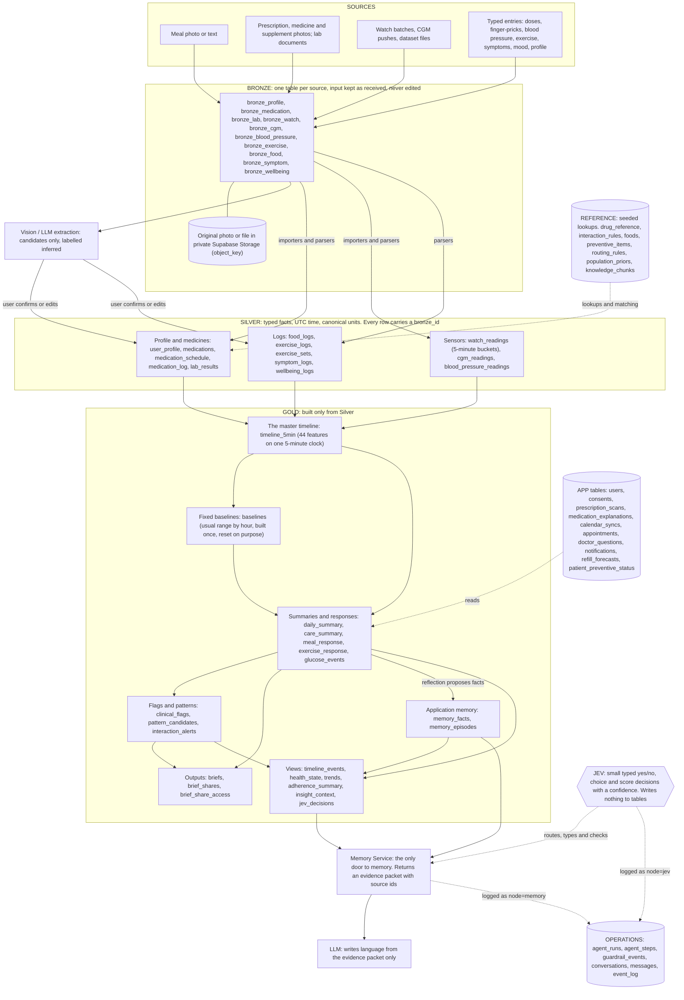
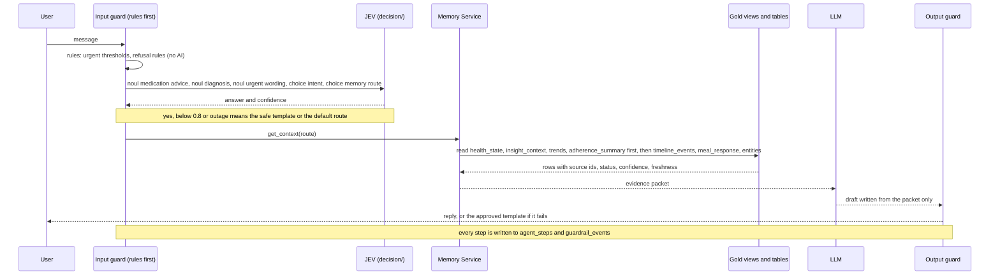
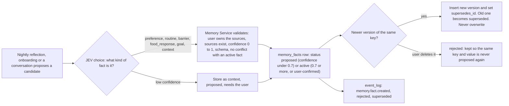

# Data flow: Bronze, Silver, Gold, the features that use them, and where JEV sits

Where every piece of data comes from, who may write it, and which feature reads which table. It follows **data model v2** ([data-model-v2.md](data-model-v2.md), built in the database on 2026-10-05; the generated column list is [../data_dictionary.md](../data_dictionary.md)) and summarises [memory.md](memory.md) for memory and JEV. **If this page disagrees with data-model-v2.md, that document wins.** Fix this page. The older [schema.md](schema.md) and [bronze-silver.md](bronze-silver.md) describe the previous (v1) schema and are kept only as history.

## 1. The whole flow

Reading it: data only moves down. Gold never writes back into Silver, and Bronze is never changed. JEV and the LLM never touch a table directly: they go through the Memory Service, and every call is logged in the Operations tables. Every typed entry now also passes through a Bronze row (its payload is the submitted form), so every Silver row can be traced to what the person actually sent.

## 2. What each layer is, for the person writing code

| Layer | Holds | Who writes rows | Can be changed? | Every table must carry |
|---|---|---|---|---|
| **Bronze** (10 tables) | `bronze_*`: the input as received (`payload` jsonb, optional `object_key` for a photo or file) | The ingest path, once per input | No. Only `processing_status` changes; the guard trigger blocks the rest | `source`, `checksum` (UNIQUE per user, so a re-sent batch does nothing), `received_at` |
| **Silver** (13 tables) | Typed facts | User, importers, and services after the user confirms | Yes for logs (soft delete, `updated_at`); sensor tables are append-only | `user_id`, `source`, `bronze_id`; UTC timestamps; canonical units (mmol/L, g, mg); NULL for "no data" |
| **App** (10 tables) | Application state and records outside the pipeline: `users`, `consents`, `prescription_scans`, `appointments`, `doctor_questions`, `notifications`, `refill_forecasts`, `patient_preventive_status`, `medication_explanations`, `calendar_syncs` | The app and services | Yes | `user_id` |
| **Reference** (11 tables) | Seeded lookups with source and licence | Seed scripts only | Versioned reload | `source`, licence |
| **Gold** (15 tables, 6 views) | Derived values and application memory | Deterministic code (`scripts/build_gold_v2.py` today), nightly reflection through the Memory Service | Recomputed; `briefs` are fixed once `ready` | `user_id`; `built_at` on derived tables |
| **Operations** (6 tables) | Logs, conversations, audit trail | The harness and services | `event_log` is append-only | Ids and digests only, never health values or free text |

All tables live in the `public` schema. The layer is a `Layer: ...` comment on every table, never part of a name. Row-level security is on for every table with no policies; only the backend connects.

`source` on Silver rows is one of `manual`, `watch`, `cgm`, `llm_estimate`, `scan`, `file_import`, `replay`, `system`, `demo_dataset` (and the older `onboarding_chat`, `health_connect`, `healthkit`). `file_import` marks rows that are purely real from a dataset file; `demo_dataset` marks simulated or derived rows, so a chart can show which points are simulated.

## 3. Sources to Bronze to Silver

| Source | Bronze | Silver it ends up in | Notes |
|---|---|---|---|
| Onboarding form or chat | `bronze_profile` | `user_profile` | Emergency contact name, phone and relationship are required in the form (nullable in the database so imported users can exist). Conditions and allergies are two free-text notes. Watch and CGM are free-text model names |
| Prescription, medicine or supplement photo | `bronze_medication` (the photo is the `object_key`) | `prescription_scans` (App) while the AI reads it, then after the user confirms: `medications`, `medication_schedule` (one row per dose time with quantity and before/after meal) and `medication_log` (pending dose rows) | Confirming is one transaction: medicines, schedule, dose rows, clash check and event log, or nothing |
| A dose confirmed or a miss reason | `bronze_medication` | `medication_log` (`taken_at` or `miss_reason`) | Status is `pending`, `taken`, `missed` or `skipped`. "Late" is computed (taken more than 60 minutes after the schedule) |
| Meal photo or text | `bronze_food` (photo as `object_key`; the raw LLM answer in `payload`) | `food_logs` (`estimated_by = llm_photo` or `llm_text`) | Shown as "Estimated" until the user confirms. A re-run with a newer model writes a new Bronze row; the log keeps its `bronze_id` unless the user accepts the new estimate |
| Watch sync | `bronze_watch` (a whole batch) | `watch_readings`: one row per 5-minute bucket (heart rate, HRV, SpO2, steps, minutes asleep) | Idempotent by `(user, recorded_at)` and by checksum |
| CGM push or file | `bronze_cgm` | `cgm_readings` | A finger-prick is stored here with `source = manual` |
| Blood pressure | `bronze_blood_pressure` | `blood_pressure_readings` | A few readings a week |
| Exercise | `bronze_exercise` (sets inside the payload) | `exercise_logs` and, for strength, `exercise_sets` | Detected sessions from the watch are also written here with `source = demo_dataset` or `watch` |
| Symptom | `bronze_symptom` | `symptom_logs` (type, severity 1 to 5, duration, note) | The note carries things like which foot felt numb |
| Mood, stress, sleep quality, energy | `bronze_wellbeing` | `wellbeing_logs` | Evening log and morning log |
| Lab result or document | `bronze_lab` | `lab_results` (HbA1c %, fasting glucose, fasting insulin only) | |
| Dataset file (CGMacros and others) | one Bronze row per person and file, `source = file_import` | the matching Silver tables | The real Dexcom glucose, meals and labs of Mr Tan are loaded this way |

## 4. Silver to Gold

| Gold table or view | Built from | Kind |
|---|---|---|
| `timeline_5min` | `watch_readings`, `cgm_readings`, `blood_pressure_readings`, `food_logs`, `exercise_logs`, `medication_log` (+ `medication_schedule`, `medications`), `wellbeing_logs`, `symptom_logs`, `user_profile` (work schedule) | Derived by code. 44 features on one 5-minute clock. Feeds the four report charts |
| `baselines` | `timeline_5min` (first 14 days of each metric; blood pressure: first 5 readings) | Derived by code. Fixed; a new one is built only on a reset |
| `daily_summary` | `timeline_5min`, the logs, `baselines` | Derived by code. Includes the share of readings on the worse side of the usual range and `declining_metrics` |
| `meal_response`, `exercise_response` | `timeline_5min` around each `food_logs` / `exercise_logs` row | Derived by code. A finding needs at least 5 comparable events before it is shown as a pattern |
| `glucose_events` | The CGM trace in `timeline_5min` (spikes, sustained highs, lows) with what was happening at the time | Derived by code |
| `clinical_flags` | `daily_summary` (`declining_metrics`), `glucose_events` lows, adherence drops | Derived by code. Each flag stores the numbers that caused it |
| `pattern_candidates` | `meal_response`, `exercise_response`, `daily_summary`, `medication_log`; at least 5 events; worded "associated with" | Derived by code, `evidence_status = derived` |
| `care_summary` | `medication_log`, `refill_forecasts`, `patient_preventive_status`, `lab_results`, `doctor_questions`, `appointments`, `clinical_flags`, `daily_summary` | Derived by code. One row per person per day for adherence, preventive health and visit preparation |
| `interaction_alerts` | `medications` against `interaction_rules` | Reference lookup, labelled `reference_matched`; supplements and TCM are "not checked" |
| `memory_facts`, `memory_episodes` | Nightly reflection and onboarding propose; the user confirms; episodes summarise `conversations` | **Application memory, where JEV helps** (section 5) |
| `briefs`, `brief_shares`, `brief_share_access` | Gold and Silver through the Memory Service; shares need `consents` | Output |
| Views `timeline_events`, `health_state`, `trends`, `adherence_summary`, `insight_context`, `jev_decisions` | Silver and Gold, recomputed on read | Read-only views (adherence counts prescription medicines only) |

Gone from v1, and where the job moved: `momentum_snapshots` and the 28-day baseline (replaced by the fixed `baselines` and the worse-side flag in `daily_summary`), `event_windows` (the timeline plus `meal_response` and `exercise_response`), `food_responses` (group `meal_response` by food), `sprint_summaries` and `cgm_sprints` (CGM is continuous), `urgent_events` (written to `event_log`, `clinical_flags` and `glucose_events`), `nudge_stats` (read from `notifications` and `memory_facts`), `daily_aggregates` (now `daily_summary`).

Evidence statuses on everything stored: `observed` (recorded directly or confirmed by the user), `derived` (a reproducible calculation), `inferred` (a model produced it, not confirmed), `reference_matched` (a lookup against unreviewed reference data). Nothing is "validated". Confidence never changes the status.

## 5. What JEV does in Gold

JEV is OpenJev behind `decision/`: it answers small typed questions (`noul` gives a probability of yes, `choice` picks one option, `score` gives a level) with a calibrated confidence. **JEV has no tables of its own.** It reads a short, de-identified state and returns an answer. The Memory Service and the guards act on the answer, and the call is logged in `agent_steps` (`node = jev`, `tool = decide`). A rule that fires always beats a JEV answer. Below the confidence floor (start at 0.8) or when JEV is down, the conservative path applies.

### 5.1 At read time: a chat message

The memory route (`choice`) decides which planes the Memory Service reads:

| Route | Tables it reads |
|---|---|
| semantic | `memory_facts`, `memory_episodes`, `user_profile` |
| temporal | `timeline_events`, `timeline_5min`, `daily_summary`, `meal_response`, `exercise_response`, `glucose_events` |
| entity | `medications`, `medication_schedule`, `foods`, `food_logs`, `appointments`, `care_summary` |
| relationship | `pattern_candidates`, `clinical_flags`, `interaction_alerts` |

On low confidence it reads semantic plus temporal with small limits.

### 5.2 At write time: a new memory fact

### 5.3 Every JEV decision and what it touches

| Decision | Type | Where it plugs in | What it affects in the data | If low confidence or JEV is down |
|---|---|---|---|---|
| Memory route | `choice` | Before retrieval | Which Gold tables the Memory Service reads (table above) | Semantic plus temporal, small limits |
| Message intent | `choice` | Input | Which specialist helper gets the message. Writes nothing | General companion, no tools that write |
| Guard: medication advice | `noul` | Input guard | Nothing stored. A yes returns the refusal template and writes `guardrail_events` | Treat as yes |
| Guard: diagnosis | `noul` | Input guard | Same, with the non-diagnostic template | Treat as yes |
| Guard: urgent wording | `noul` | Input guard | Same, and the urgent screen | Treat as yes |
| Memory candidate type | `choice` | Write path | `memory_facts.category` and the key namespace | Store as `context`, `proposed` |
| Relevance | `noul` | Brief narrative and output guard | Whether a sentence stays; the evidence id must still exist | Drop the sentence |
| Contradiction (stretch) | `noul` | Write path | Whether two active facts conflict | Keep both and ask the user |
| Item type from an image | `choice` | After Bronze | Which Silver pipeline handles the object (scan, supplement or meal) | Ask the user |

**JEV never decides:** any number, threshold, aggregate, baseline, flag or food response; urgent escalation; interaction lookup; dose schedules or adherence status; meal nutrients (the LLM estimates those and they are labelled `inferred`); anything that suppresses a safety output. It also never receives a name, NRIC, phone number or address.

## 6. Feature routing on the v2 tables

For each feature: what a user action writes (Bronze then Silver or App), and what the feature reads. Gold is read through the Memory Service, views or the report builder; the app never writes Gold.

| Feature | Writes | Reads |
|---|---|---|
| F1 Onboarding | `bronze_profile` then `user_profile`; `consents`; generates the first `medication_log` rows | none |
| F2 Medication capture | Photo to `bronze_medication` and `prescription_scans`; after confirmation `medications`, `medication_schedule`, `medication_log`; `interaction_alerts` | `drug_reference`, `drug_aliases` |
| F3 Medication explainer | `medication_explanations` (the saved explanation), `doctor_questions` (a question asked from the page) | `medications`, `medication_schedule` (the person's own label); a web search through the model. Not the 250k Medicines file (D-071) |
| F4 Adherence | `medication_log` (taken, missed with reason, skipped); `notifications`; `refill_forecasts` | `medication_schedule`, `adherence_summary` (view), `care_summary` |
| F5 Clash checker | `interaction_alerts`, `doctor_questions` (the button on an alert) | `medications`, `interaction_rules`, `drug_reference`, `drug_aliases`; an AI model with a web search as a second source (D-073) |
| F6 Tracking and logging | `bronze_*` then `cgm_readings` (finger-prick), `food_logs`, `exercise_logs` and `exercise_sets`, `symptom_logs`, `wellbeing_logs`, `blood_pressure_readings`, `lab_results`; `watch_readings` and `cgm_readings` from syncs; weight in `user_profile` | `timeline_5min`, `daily_summary` |
| F7 CGM and personal food response | none (computed) | `meal_response`, `food_logs`; gentlest and spikiest foods = `meal_response` grouped by food, at least 2 meals |
| F8 Fixed baseline and decline flag | `baselines`, `daily_summary`, `clinical_flags` (all by code) | `timeline_5min`, `baselines` |
| F9 Targeted symptom check-ins | the question is a `notifications` row (kind `checkin`, payload with the flag id and question key); the answer goes through `bronze_symptom` to `symptom_logs` | `clinical_flags`, `care_summary` |
| F10 Urgent escalation (on hold) | `event_log`; `clinical_flags` (low glucose); `glucose_events` (low) | `cgm_readings` (rules, no AI) |
| F11 Lifestyle coach | `notifications` (kind `nudge`) | `memory_facts`, `pattern_candidates`, `daily_summary`, `meal_response`; nudge timing learned from `notifications` (opened and acted) |
| F12 Doctor brief | `briefs`, `brief_shares`, `brief_share_access` | `timeline_5min` (the four charts), `baselines`, `daily_summary`, `care_summary`, `meal_response`, `exercise_response`, `glucose_events`, `lab_results`, `clinical_flags`, `pattern_candidates`, `interaction_alerts`, `doctor_questions`, `user_profile` |
| F13 Preventive care and scheduler | `appointments`, `patient_preventive_status` | `preventive_items`, `care_summary` (overdue and due soon), `clinical_flags`, `lab_results` (HbA1c) |
| F14 Healthcare preparation | `doctor_questions` | `care_summary`, `briefs` |
| F15 Companion chat | `conversations`, `messages`, `agent_*`; refused advice adds a `doctor_questions` row | Memory Service (section 5.1) |
| F16 What Smart Health has learned | `memory_facts` | `memory_facts`, evidence rows |
| F17 Multilingual and TTS | none | `user_profile.language` |
| F18 Lifestyle timeline and day traces | none | `timeline_5min`, `meal_response`, `exercise_response`, `glucose_events`, `baselines` |

## 7. How it is built today, and one catch

Built and loaded on 2026-10-05 (data-model-v2.md section 11): the schema is Alembic 0017 to 0020; the demo patient comes from `scripts/generate_mr_tan.py` and `scripts/load_mr_tan_v2.py`; Gold is built by `scripts/build_gold_v2.py` (the timeline is Python, the SQL view `v_timeline_5min` is not written yet). Dependency order of the tables: extensions, enums and `users`; Reference; the ten Bronze tables; Silver; App and Gold; Operations; then the views.

**The catch (still true).** Four columns in kept tables point at Gold or Operations tables: `appointments.brief_id` and `doctor_questions.brief_id` (to `briefs`), `prescription_scans.agent_run_id` (to `agent_runs`) and `conversations.summary_episode_id` (to `memory_episodes`). They exist as real foreign keys since migration 0014. Everything else points the right way: Gold, Operations and views point at Silver, App and Reference, never the reverse.
