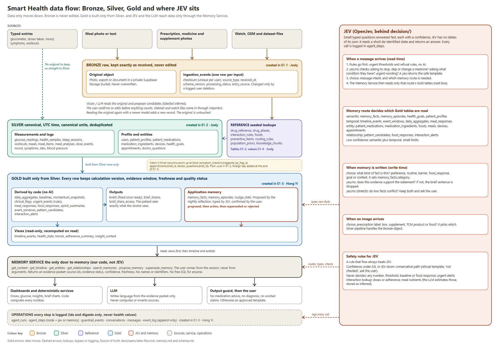
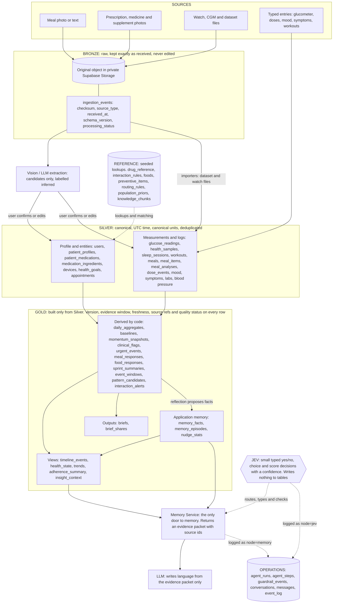
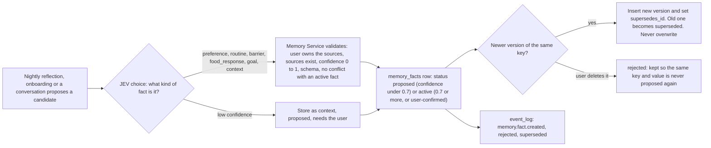

# Data flow: Bronze, Silver, Gold and where JEV sits

A one-page picture for whoever creates the database (E1) and for anyone who needs to know where a piece of data comes from and who may write it. It summarises [memory.md](memory.md) (sections 2 to 9 and 12) and [schema.md](schema.md) (the layer map in section 0b and the relationships in section 10). **If this page disagrees with those two, they win.** Fix this page.

## 1. The whole flow

The picture above is the full version ([SVG source](img/data-flow.svg), open it in a browser to zoom). The diagram below is the same flow as text that GitHub draws, so it stays easy to diff.

Reading it: data only moves down. Gold never writes back into Silver, and Bronze is never changed. JEV and the LLM never touch a table directly: they go through the Memory Service, and every call is logged in the Operations tables.

## 2. What each layer is, for the person writing the migration

| Layer | Holds | Who writes rows | Can be changed? | Every table must carry | Created in |
|---|---|---|---|---|---|
| **Bronze** | `ingestion_events` and the stored original object (photo, export, document) | The ingest path, once per input | No. Only a user-requested deletion or retention expiry, both logged in `event_log` | `checksum`, `source_type`, `received_at`, `schema_version`, `processing_status`, `entry_source`; UNIQUE (`user_id`, `checksum`) | E1-1 (Joely) |
| **Silver** | Canonical records, including AI candidates until confirmed | User, importers, and services after the user confirms | Yes, through the app's state machines | `user_id`; UTC timestamps; canonical units (mmol/L, mg, g, seconds); `entry_source`; `evidence_status` where an AI estimated it; NULL for "no data"; unique (`user_id`, `source`, `external_id`) so imports are safe to repeat | E1-2 (Joely) |
| **Reference** | Seeded lookups with their source and licence | Seed scripts only (never ad-hoc SQL) | Versioned reload | `source`, licence, version | E1-2 (Joely) creates, E1-4 loads |
| **Gold** | Derived values and application memory | Deterministic code, the nightly reflection (through the Memory Service) and the user's confirmations | Recomputed. `briefs` are fixed once `ready` | Calculation or model version, evidence window, freshness timestamp, source refs, quality status | E1-3 (Hong Yi) |
| **Operations** | Logs, conversations, audit trail | The harness and services | `event_log` is append-only for the app role | Ids and digests only, never health values or free text | E1-3 (Hong Yi) |

All tables live in the `public` schema. The layer is a label in the layer map (schema.md section 0b), never part of a table name. Row-level security is on for every table with no policies; only the backend connects.

## 3. Sources to Bronze to Silver

| Source | Bronze | Silver it ends up in | Notes |
|---|---|---|---|
| Meal photo or text | `ingestion_events` (`meal_photo` or `meal_text`) plus the object | `meal_analyses` (raw LLM output, model and prompt version) then `meals` and `meal_items` (`estimated_by = llm_estimate`, `evidence_status = inferred`) | Shown as "Estimated" until the user confirms. A re-run adds a new `meal_analyses` row and marks the old one `superseded` |
| Prescription, medicine or supplement photo | `ingestion_events` (`prescription_image`, `medication_image`, `supplement_image`) plus the object | `prescription_scans` then, after the user confirms, `patient_medications` and `medication_ingredients` | Confirming is one transaction: medicines, dose events, clash check and event log, or nothing |
| Watch, CGM or dataset file | `ingestion_events` (`wearable_export`, `dataset_import`) plus the file | `glucose_readings`, `health_samples`, `sleep_sessions`, `workouts`, `meals` (dataset meals keep their measured macros) | Dates shifted once per person; rows labelled `demo_dataset`; imports are idempotent; insulin columns are discarded |
| Document (for example a lab result) | `ingestion_events` (`document`) plus the object | `lab_results` and related rows | |
| Typed entries (glucometer, a dose taken, mood, symptoms, a workout) | **None.** There is no original to keep | Straight into the matching Silver table with `entry_source = manual` | |

## 4. Silver to Gold

| Gold table or view | Built from | Kind |
|---|---|---|
| `daily_aggregates` | `glucose_readings`, `health_samples`, `sleep_sessions`, `workouts`, `dose_events`, `meals` | Derived by code |
| `baselines`, `momentum_snapshots` | `daily_aggregates` (28-day baseline, 7-day trend) | Derived by code |
| `clinical_flags` | `baselines`, `momentum_snapshots`, adherence and symptom reports | Derived by code |
| `urgent_events` | `glucose_readings`, `symptom_logs` through fixed rules, no AI | Rule-based |
| `meal_responses`, `food_responses` | `meals` plus measured glucose (CGM sprints only); then per user and food, at least 2 observations | Derived by code |
| `sprint_summaries` | `cgm_sprints` and `glucose_readings` | Derived by code |
| `event_windows`, `pattern_candidates` | Anchors (`meals`, `workouts`, `dose_events`, `sleep_sessions`) with glucose and watch data; at least 5 matched pairs; worded "associated with" | Derived by code |
| `interaction_alerts` | `patient_medications` against `interaction_rules` | Reference lookup, labelled `reference_matched` |
| `memory_facts`, `memory_episodes` | Nightly reflection and onboarding propose; the user confirms; episodes summarise `conversations` | **Application memory, where JEV helps** (section 5) |
| `nudge_stats` | Counters of nudges sent and acted on | Derived by code |
| `briefs`, `brief_shares`, `brief_share_access` | Gold and Silver through the Memory Service; shares need `consents` | Output |
| Views `timeline_events`, `health_state`, `trends`, `adherence_summary`, `insight_context` | Silver and Gold, recomputed on read | Read-only views |

Evidence statuses on everything stored: `observed` (recorded directly or confirmed by the user), `derived` (a reproducible calculation), `inferred` (a model produced it, not confirmed), `reference_matched` (a lookup against unreviewed reference data). Nothing is "validated". Confidence never changes the status.

## 5. What JEV does in Gold

JEV is OpenJev behind `decision/`: it answers small typed questions (`noul` gives a probability of yes, `choice` picks one option, `score` gives a level) with a calibrated confidence. **JEV has no tables of its own.** It reads a short, de-identified state and returns an answer. The Memory Service and the guards act on the answer, and the call is logged in `agent_steps` (`node = jev`, `tool = decide`). A rule that fires always beats a JEV answer. Below the confidence floor (start at 0.8) or when JEV is down, the conservative path applies.

### 5.1 At read time: a chat message

The memory route (`choice`) decides which planes the Memory Service reads:

| Route | Tables it reads |
|---|---|
| semantic | `memory_facts`, `memory_episodes`, `health_goals`, `patient_profiles` |
| temporal | `timeline_events`, `event_windows`, `daily_aggregates`, `meal_responses` |
| entity | `patient_medications`, `medication_ingredients`, `foods`, `meals`, `devices`, `health_goals`, `appointments` |
| relationship | `pattern_candidates`, `food_responses`, `interaction_alerts` |

On low confidence it reads semantic plus temporal with small limits.

### 5.2 At write time: a new memory fact

### 5.3 Every JEV decision and what it touches

| Decision | Type | Where it plugs in | What it affects in the data | If low confidence or JEV is down |
|---|---|---|---|---|
| Memory route | `choice` | Before retrieval | Which Gold tables the Memory Service reads (table above) | Semantic plus temporal, small limits |
| Message intent | `choice` | Input | Which specialist helper gets the message. Writes nothing | General companion, no tools that write |
| Guard: medication advice | `noul` | Input guard | Nothing stored. A yes returns the refusal template and writes `guardrail_events` | Treat as yes |
| Guard: diagnosis | `noul` | Input guard | Same, with the non-diagnostic template | Treat as yes |
| Guard: urgent wording | `noul` | Input guard | Same, and the urgent screen | Treat as yes |
| Memory candidate type | `choice` | Write path | `memory_facts.category` and the key namespace | Store as `context`, `proposed` |
| Relevance | `noul` | Brief narrative and output guard | Whether a sentence stays; the evidence id must still exist | Drop the sentence |
| Contradiction (stretch) | `noul` | Write path | Whether two active facts conflict | Keep both and ask the user |
| Item type from an image | `choice` | After Bronze | Which Silver pipeline handles the object (scan, supplement or meal) | Ask the user |

**JEV never decides:** any number, threshold, aggregate, baseline, slope or food response; urgent escalation; interaction lookup; dose schedules or adherence status; meal nutrients (the LLM estimates those and they are labelled `inferred`); anything that suppresses a safety output. It also never receives a name, NRIC, phone number or address.

## 6. Build order for E1 and one catch

The dependency order of the tables (and the owner of each step):

1. Extensions (pgvector), enums, `users`. (Joely)
2. **Reference tables.** They depend on nothing, and Silver tables point at them (`patient_medications` to `drug_reference`, `meal_items` to `foods`). (Joely, E1-2)
3. **`ingestion_events`.** `meal_analyses` points at it. (Joely, E1-1)
4. **Silver tables.** (Joely, E1-2)
5. **Gold and Operations tables and views.** They point at Silver, Reference and each other. (Hong Yi, E1-3)
6. **Foreign keys that point from Silver up to Gold** (see below). (Hong Yi, end of E1-3)
7. **Values**, in the same order: reference data, then datasets into Silver, then the demo patient and simulator. (Joely, E1-4)

**The catch.** Three Silver tables point at Gold tables:

| Silver column | Points at |
|---|---|
| `symptom_checkins.triggered_by_flag_id` | `clinical_flags` |
| `appointments.brief_id` | `briefs` |
| `doctor_questions.brief_id` | `briefs` |

Gold tables are built after Silver, so these three cannot be real foreign keys when Silver is created. **Joely creates them as plain nullable `uuid` columns in E1-2. Hong Yi adds the three foreign-key constraints in E1-3, after the Gold tables exist.** Without this the two tasks wait on each other. Inside E1-3 there is one more loop of the same kind: `conversations.summary_episode_id` and `memory_episodes.conversation_id`; create one without its constraint and add it after the other table exists.

Everything else points the right way: Gold, Operations and views point at Silver and Reference, never the reverse.
